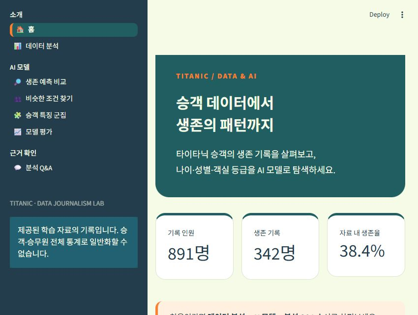
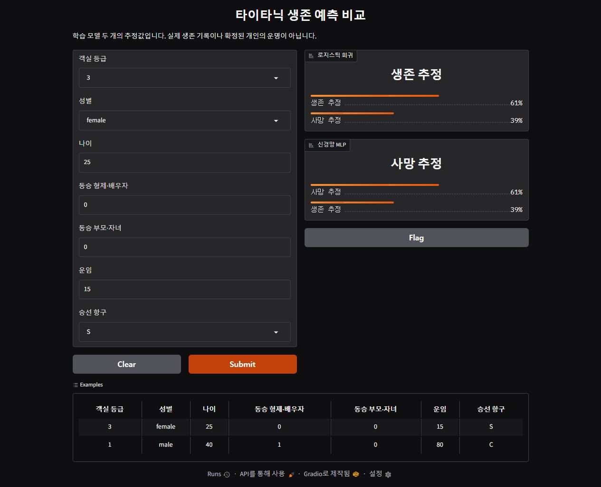
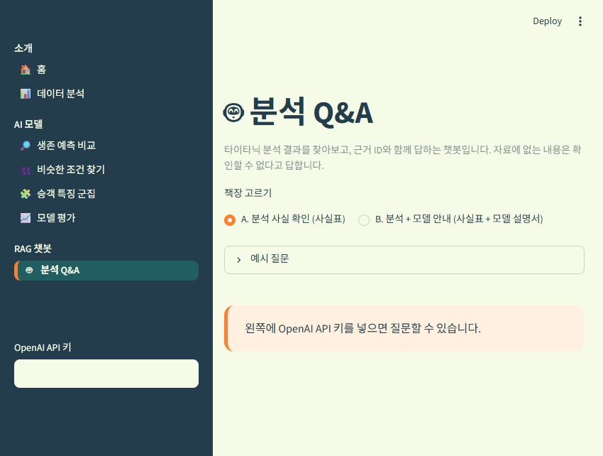

# 타이타닉 STEP1 · STEP2 · STEP3

원본 Olist 프로젝트의 12개 학습 노트북 → Gradio 서빙 → 다중 페이지 Streamlit 구조를 타이타닉에 맞게 재구성했습니다. 원본 예제를 덮어쓰지 않았습니다.

## 대시보드 화면

아래 이미지는 저장소에 포함된 실행 화면 캡처입니다. 이미지를 클릭하면 크게 볼 수 있습니다. README의 이미지는 미리보기이며, 직접 필터를 바꾸거나 질문하려면 아래 실행 방법으로 앱을 실행하세요.

### 1. 홈 — 승객 데이터에서 생존의 패턴까지

[](./home_colors_preview.png)

홈 화면은 분석할 자료와 주요 메뉴를 한눈에 보여줍니다. 캡처에는 **기록 인원 891명, 생존 기록 342명, 자료 내 생존율 38.4%**가 표시됩니다. 왼쪽 메뉴에서 데이터 분석, 생존 예측 비교, 비슷한 조건 찾기, 승객 특징 군집, 모델 평가, 분석 Q&A로 이동합니다.

이 수치는 제공된 `train.csv`에 기록된 사람을 기준으로 계산한 값입니다. 승객과 승무원을 포함한 타이타닉 전체 탑승자의 통계는 아닙니다. 홈 캡처의 ‘근거 확인’ 메뉴 그룹은 이후 ‘RAG 챗봇’으로 변경했습니다.

### 2. Gradio — 같은 조건을 두 모델로 예측

[](./gradio_preview.png)

객실 등급, 성별, 나이, 동승 가족 수, 운임, 승선 항구를 입력하고 **Submit**을 누르면 로지스틱 회귀와 MLP 신경망의 추정 결과를 비교합니다.

캡처의 입력은 **3등급·여성·25세·동승 가족 0명·운임 15·승선 항구 S**입니다. 이 예시에서 로지스틱 회귀의 생존 추정은 약 **61%**, MLP 신경망의 생존 추정은 약 **39%**로 서로 다르게 나타납니다. 이 숫자는 해당 입력에 대한 모델의 추정값이며, 모델 정확도나 역사 속 개인의 실제 생존 여부를 뜻하지 않습니다.

### 3. RAG 챗봇 — 근거를 찾아 답하는 분석 Q&A

[](./qa_sidebar_preview.png)

왼쪽에 **OpenAI API 키**를 입력하고, 본문의 **책장 고르기**에서 답변에 사용할 자료를 선택합니다.

- **A. 분석 사실 확인:** 계산해 저장한 사실표에서 분석 수치를 찾습니다.
- **B. 분석 + 모델 안내:** 사실표와 모델 설명서에서 수치·입력 항목·해석의 한계를 찾습니다.

캡처는 API 키를 입력하기 전 화면으로, ‘예시 질문’과 키 입력 안내가 보입니다. 실제 질문·답변 결과가 찍힌 이미지는 아닙니다. 키를 입력하고 Enter를 누른 뒤 질문하면, 검색한 근거와 함께 답변하고 `[F03]` 같은 근거 ID를 표시하도록 구성했습니다. 자료에 없는 질문에는 ‘제공된 자료로는 확인할 수 없습니다.’라고 답하도록 설정했습니다.

API 키는 공개하지 마세요. API 사용 시 질문과 선택한 근거가 OpenAI로 전송되며 별도 비용이 발생할 수 있습니다.

## 시작
이 폴더의 실행.cmd를 더블클릭하세요. 처음에는 전용 환경·패키지 설치와 모델 학습을 수행합니다. 정상 결과는 Streamlit 홈 화면입니다. Gradio_실행.cmd는 별도 Gradio 화면을 엽니다. 서버 창을 닫으면 종료됩니다.

수동 실행(이 폴더의 PowerShell):
```
python -m venv .venv
.venv\Scripts\python.exe -m pip install -r requirements.txt
.venv\Scripts\python.exe STEP3_Local_Deploy/titanic_dashboard/train_all.py
.venv\Scripts\python.exe -m streamlit run STEP3_Local_Deploy/titanic_dashboard/app.py
```
STEP1은 01→10 순서이며 07은 세 개 파일입니다. 각 노트북의 코드와 실제 출력으로 학습 과정을 확인하세요. STEP2는 저장된 로지스틱·신경망 모델을 읽습니다. STEP3은 같은 모델과 자료를 불러옵니다.

## 원본과의 대응
| Olist | Titanic |
|---|---|
| 01~03 소개·불러오기·이해 | 동일 단계, 제공 CSV 사용 |
| 04 여러 표 병합 | 분석 자료 준비, 중복 데이터 병합 금지 |
| 05 탐색 | 생존율·결측치·나이 비교 |
| 06 상품 KNN | 비슷한 승객 조건 검색 |
| 07-1 리뷰 로지스틱 | 생존 로지스틱 |
| 07-2 리뷰 LSTM | 표 데이터 MLP 신경망 |
| 07-3 리뷰 BERT | 표 데이터 Gradient Boosting (BERT 아님) |
| 08 판매자 군집 | 승객 특징 군집 |
| 09 판매자 이탈 | 생존 예측 모델 비교·선택 |
| 10 사업 전략 | 기사 사실표·모델 설명서 |
| STEP2 Gradio 모델 2개 | 로지스틱·MLP 비교 화면 |
| STEP3 app/views/utils/data/model | 동일 폴더 분리 방식 |
| RAG Q&A | 로컬 사실 조회 + 선택적 API RAG |

판매자·주문·리뷰·규정 데이터가 없으므로 관련 기능과 규정 PDF를 지어내지 않았습니다. API RAG는 키를 직접 입력할 때만 외부 서비스로 질문과 선택 근거를 전송합니다. 별도 비용이 발생할 수 있습니다. 기본 로컬 조회는 API 키가 필요 없습니다.

Python 3.12 환경에서 검증하며 3.14.7에서는 직접 검증하지 않았습니다. 학습 자료에 생존 정답이 있는 891명만 평가에 사용합니다. test.csv와 gender_submission.csv는 정답으로 사용하지 않습니다. 두 원본 CSV는 같은 기록의 다른 표현이므로 합산하지 않습니다. 이름·표 번호는 화면에 표시하지 않습니다. 원출처와 이용 조건은 제출 전 확인하세요.
